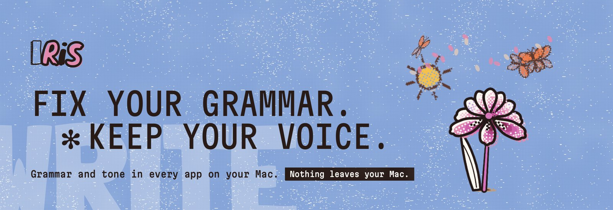
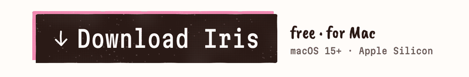
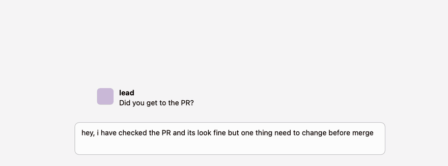
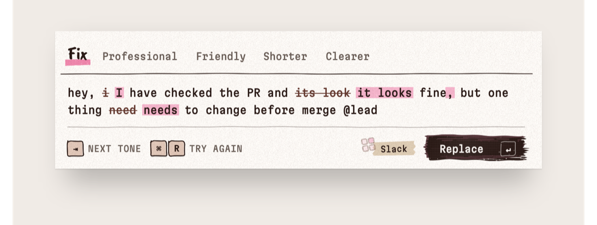
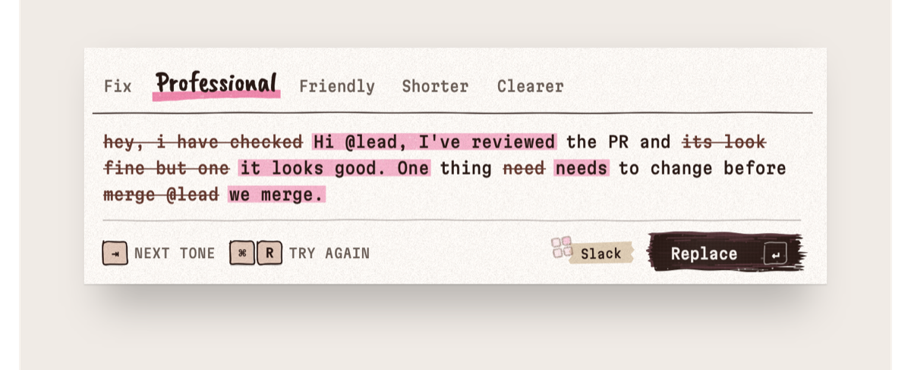
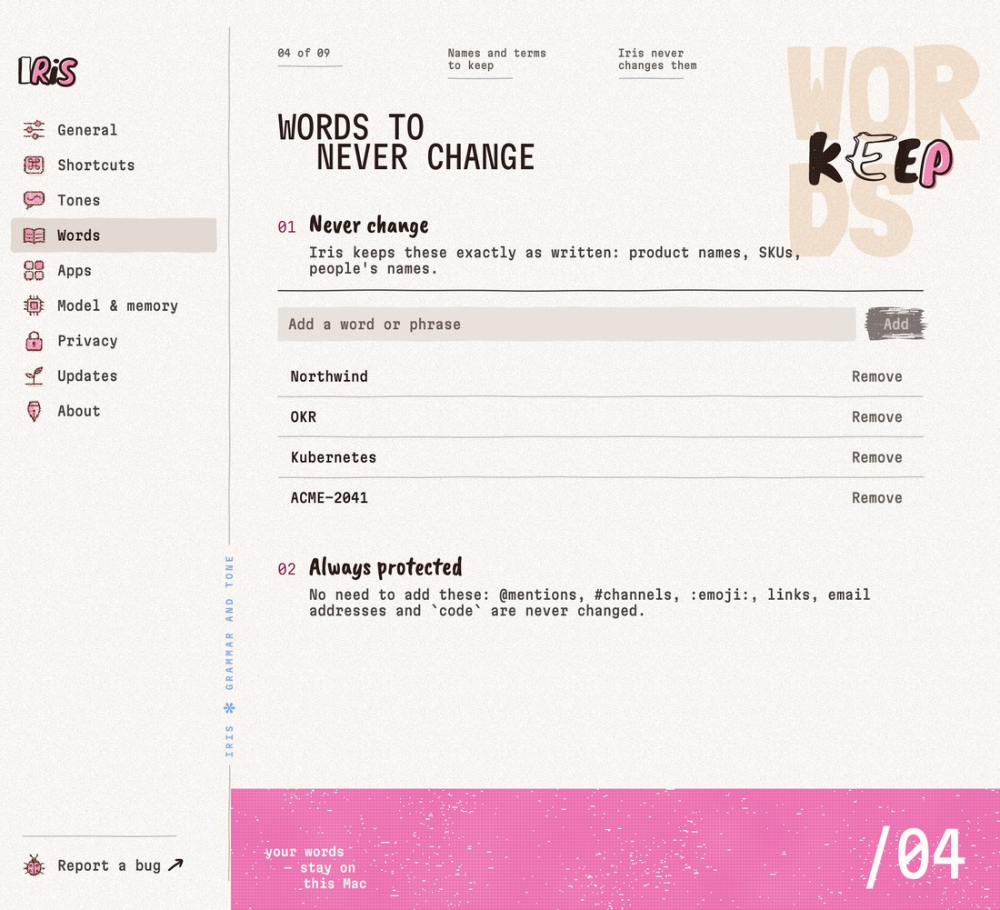
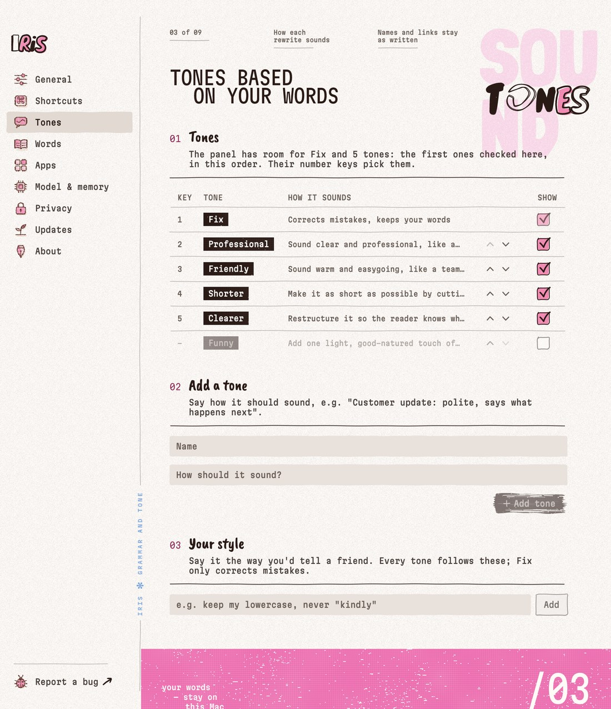
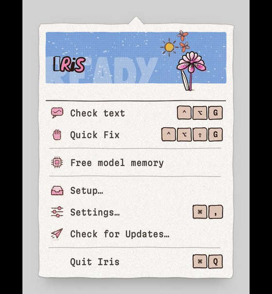
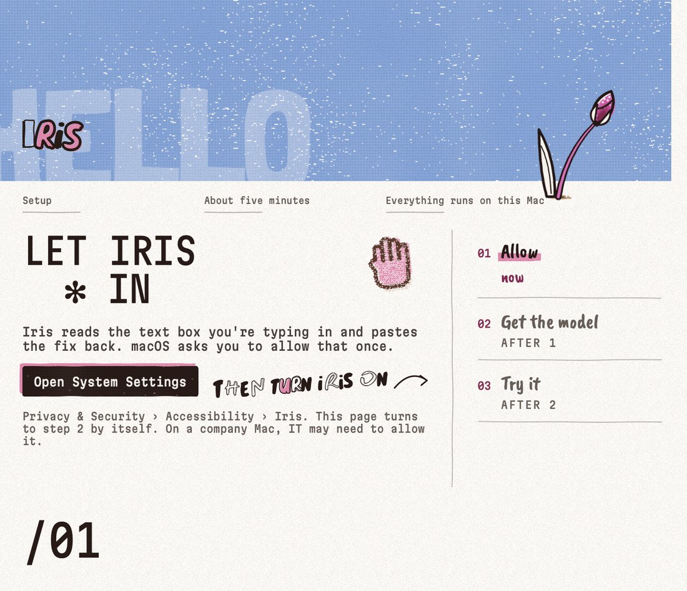
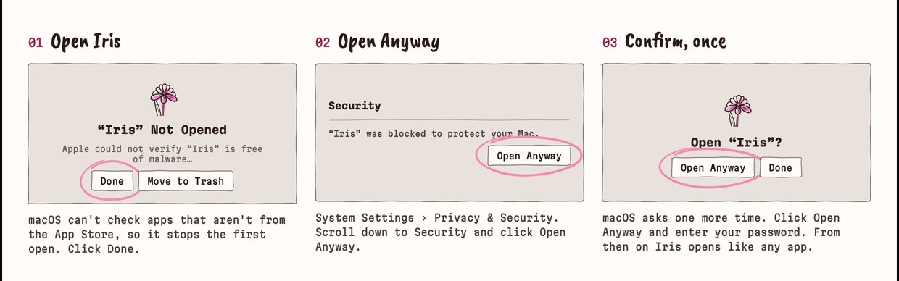

**Iris fixes your grammar and changes your tone in any app on your Mac: Slack, Mail, Notes, your browser.** Press <kbd>⌃</kbd> <kbd>⌥</kbd> <kbd>G</kbd> in any text box, read what Iris would change, and press <kbd>Return</kbd>. It runs entirely on your Mac, so your messages never go to a server.

<a href="https://github.com/imaxisXD/iris/releases/latest/download/Iris.zip"></a>

<p align="center"></p>

## Why Iris

- **Private by design.** The model runs on your Mac with Apple's MLX. Your text is never sent anywhere: no account, no cloud, no tracking. It even works offline once the model is in.
- **Works where you write.** Any app with a text box: Slack, Mail, Messages, Notes, Chrome, Safari, Electron apps. No plug-ins, no copy-and-paste into a chatbot.
- **Fixes, not rewrites.** Fix corrects grammar and spelling and leaves your words, your style and your casual "hey" alone. Text that's already fine stays exactly as it is.
- **Trained for the job.** Iris's own models learned Fix and the tones from thousands of worked examples, so Fix leaves the rest of your message alone and a tone keeps everything you said.
- **Your words stay yours.** @mentions, #channels, :emoji:, links, email addresses and `code` are never touched, and neither are the names and terms you add. If the model would drop one, Iris keeps your text instead.
- **See every change.** Each fix is marked like an editor would: removed words struck through, Iris's words in pink. Nothing is replaced until you say so.
- **Fast.** After the first check, a typical fix comes back in about 0.3 seconds (measured on an M3 Max).
- **Free and open source**, under the MIT license.

## What it does

### Fix, or change the tone



Press <kbd>⌃</kbd> <kbd>⌥</kbd> <kbd>G</kbd> in a text box, or select some text first. The panel opens on **Fix**. Press <kbd>Tab</kbd> for a tone:



**Professional**, **Friendly**, **Shorter** and **Clearer** are built in, **Funny** is one click away, and you can add your own ("Customer update: polite, says what happens next"). <kbd>⌘</kbd> <kbd>R</kbd> tries again, <kbd>Return</kbd> replaces your text, and <kbd>⌘</kbd> <kbd>Z</kbd> in your app undoes it.

### Quick Fix, without the panel


<kbd>⌃</kbd> <kbd>⌥</kbd> <kbd>⇧</kbd> <kbd>G</kbd> fixes the text box you're in and replaces it straight away. Iris only does that when it's safe: a big rewrite, a translation or text that can't be edited opens the panel so you can look first, and if you've moved on before the fix is ready, Iris leaves your text alone.

### Words Iris never changes



Add product names, people's names, SKUs and jargon once, and Iris keeps them exactly as written. Put a word back after Iris changed it, and Iris learns to leave it alone.

### Make it yours



- **Your style**, in your own words ("never use exclamation marks", "sign off with -A"), followed by every tone.
- **A starting tone per app**, for example Professional in Mail.
- **Turned off in apps** where Iris should never read text. Password managers are on the list from the start, and Iris never reads password fields.
- **Your own shortcuts** for both keys.
- **Writing in Hinglish or another language?** Fix translates it to English and shows your original beside it.

### Lives in your menu bar



No Dock icon and no window to manage. The flower in the menu bar shows what Iris is doing, and Iris frees the model's memory by itself when you haven't used it for a while.

### Set up in three steps



Allow Iris to read the text box you're typing in, download the model once, and try it on a practice sentence. Iris walks you through each step and tells you what to do if one gets stuck.

## Requirements

- A Mac with **Apple Silicon** (M1 or later) and **macOS 15** or later.
- **8 GB of memory** runs the Lighter model; with **16 GB or more**, Best quality. Iris recommends the one that suits your Mac, and you can switch in Settings › Model & memory.
- About **4 to 5 GB of disk space** for the model, downloaded once from Hugging Face.
- **Windows** is coming, as a beta.

## Install

1. **[Download Iris](https://github.com/imaxisXD/iris/releases/latest/download/Iris.zip)** and open the zip.
2. Drag **Iris** into your **Applications** folder.
3. Open it. The first time, macOS asks you to confirm it, once:



4. Iris opens its setup: allow it to read the text box you're typing in, download the model, and try it on a practice sentence.

**Why does macOS ask?** Iris is free and open source, and Apple charges a yearly fee to vouch for apps, which this project doesn't pay. Every release is signed with the same certificate instead, so you confirm Iris once and allow it once, and both stick through updates. The source is all here if you'd rather check it, or build it yourself.

**Updating:** choose **Check for Updates…** in Iris's menu. When a new version is out, **Update & reopen** downloads it, makes sure it's Iris and signed like your copy, puts it in place and opens it. Your settings, words, model and permission stay.

<details>
<summary>Build it from source instead</summary>

You need the full **Xcode** app (26.4 or later), not just the Command Line Tools, and **Rust** (from [rustup.rs](https://rustup.rs)).

```bash
git clone https://github.com/imaxisXD/iris.git
cd iris
sudo xcode-select -s /Applications/Xcode.app/Contents/Developer
sudo xcodebuild -license accept && sudo xcodebuild -runFirstLaunch
xcodebuild -downloadComponent MetalToolchain   # compiles MLX's shaders, about 840 MB
curl https://sh.rustup.rs -sSf | sh            # Rust, for Iris's interface
scripts/make-signing-cert.sh                   # a signing identity for this Mac
scripts/update.sh --local                      # builds Iris and installs it in /Applications
```

The first build compiles MLX and the interface and takes several minutes. A copy built this way updates itself from the checkout: **Check for Updates…** pulls, rebuilds and reopens Iris. If Rust isn't there when it updates, it installs it first, in your home folder, without a password.

The signing step gives your builds a stable identity, so the Accessibility permission survives updates; macOS lists that certificate as not trusted, which is expected for one only your Mac uses.

- **"tool 'xcodebuild' requires Xcode"**: run the `xcode-select` line.
- **"You have not agreed to the Xcode license agreements"**: run the `xcodebuild -license` line.
- **"cannot execute tool 'metal' due to missing Metal Toolchain"**: run the `MetalToolchain` line.
- **"cargo: command not found"**: run the Rust line, then open a new Terminal window.

</details>

<details>
<summary>If something goes wrong</summary>

- **There's no Open Anyway button**: open Iris once first, then look again in System Settings › Privacy & Security, under Security.
- **Setup says "the switch is on, but I can't see it"**: macOS kept the permission of an older copy. Run `tccutil reset Accessibility local.iris.app` in Terminal, then allow Iris again from setup.
- **On a company-managed Mac**, check with IT first: it may block apps from outside the App Store, or Accessibility.

</details>

## Privacy

- **Your text stays on your Mac.** Iris reads the text box you're typing in only when you press its keys, and the model runs locally.
- **The only downloads** are the model itself, from huggingface.co, the first time you set up Iris, and, when you choose **Check for Updates…**, the latest version number from GitHub, then the new version itself if you choose **Update & reopen**.
- **Accessibility** is how Iris reads the box you're in and pastes the fix back. It's only used when you ask.
- **Your clipboard** is borrowed for a moment to paste the fix, marked as temporary so clipboard managers skip it, and put back afterwards.
- No analytics, no crash reporting, no account.

## Known limits

- Built for English. Other languages are translated to English rather than corrected.
- Slack may paste a linked @mention back as plain text.
- Pasting uses the ⌘A and ⌘V key positions of a QWERTY keyboard.
- Iris's models are trained from Google's Gemma 4, under the [Gemma Terms of Use](https://ai.google.dev/gemma/terms). Read them before rolling Iris out to a team.

## For developers

Iris is two programs in one app. Its interface is written in Rust with [GPUI](https://www.gpui.rs) (`gpui/`): the panel, the menu bar slip, setup, Settings and every message, the shortcuts, reading and pasting text. The model runs in a small Swift helper beside it (`gpui/brain`), which is the Swift engine below; the two talk in lines of JSON. The earlier SwiftUI interface (`Sources/Iris`) is deprecated: it gets no changes and is kept only as a reference until it's removed.

| Part | What it does |
|---|---|
| `TextBridge` | Reads the focused text box through Accessibility, off the main thread with a 250 ms timeout, and pastes back through a temporary clipboard lease. |
| `Protector` | Swaps @mentions, links, code and your words for placeholders before the model sees the text, and refuses an answer that dropped one. |
| `Rewriter` | Protect, generate, restore, guard: one pipeline for Fix and every tone, each attempt under a time limit. |
| `Engine` | Iris's models (Gemma 4, trained for Iris's jobs) on MLX: one shared load, a prefilled prompt cache per tone (Fix in about 0.3 s instead of 0.8 s), unloading when idle or under memory pressure, and a drafter model that writes answers about twice as fast. |
| `SetupProgress`, `QuickFixLanding`, `ProblemNote` | The rules for setup, Quick Fix and error messages, kept free of windows so they're unit-tested. |

```bash
swift test                                        # the rules, no windows
(cd gpui && cargo test)                           # the interface's rules
scripts/build-app.sh                              # build build/Iris.app without installing it
gpui/scripts/build-app.sh                         # a development copy (Iris GPUI, on ⌃⌥I) beside the installed Iris
(cd gpui && cargo run --features tooling -- --snap <dir>)   # render the panel's states
```

Build through the scripts rather than `swift build` or `cargo build` alone: only Xcode's build system compiles MLX's Metal shaders, and the app needs its helper beside it. The look follows a risograph zine: printed paper, pen lines, a pink plate printed off register, brush lettering. The README's pictures come from `Iris --readme-images <dir>` (the SwiftUI app), and the Settings ones from the interface's scenes (`--scene readme-words`, `--scene settings-tones`).

## Credits

- Named after the iris that grows beside your text when you call it.
- [MLX](https://github.com/ml-explore/mlx-swift) and [MLX Swift LM](https://github.com/ml-explore/mlx-swift-lm) by Apple, and [Gemma](https://ai.google.dev/gemma) by Google.
- Fonts under the SIL Open Font License: Martian Mono, Caveat Brush, Rubik Doodle Shadow, Knewave, Londrina Solid and Mansalva. Their licenses are in `Sources/Iris/Resources/Fonts`.
- The [`tactile-design`](https://github.com/kosta4a/tactile-design) design rules, MIT licensed.

## License

[MIT](LICENSE).
